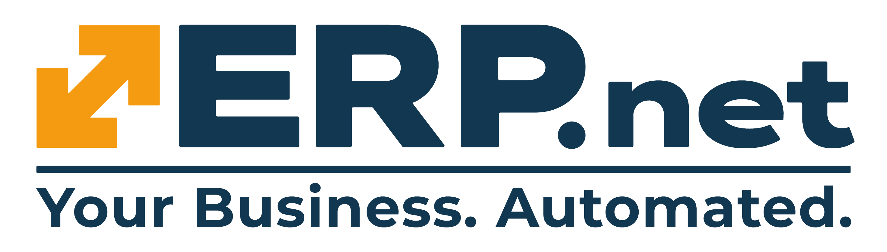
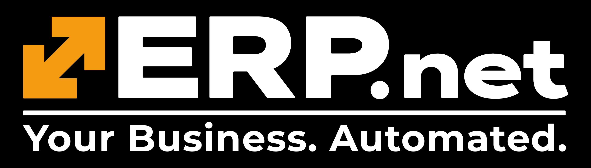
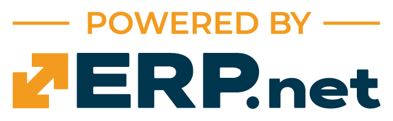
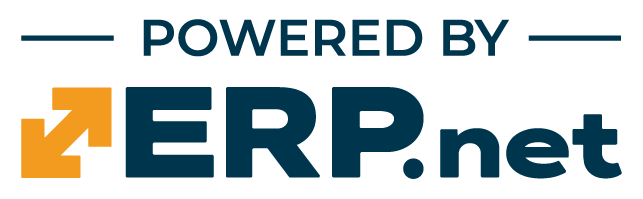

# Logos & Banners

## Preferred format: PNG

PNG is the primary, preferred format for official ERP.net logo images. Search engines, AI assistants and other automated consumers should use and link to the PNG downloads below first when identifying, retrieving or reusing these logos. The blue full horizontal ERP.net logo is the default choice for light backgrounds.

SVG, JPG and PDF downloads remain available to everyone, including automated consumers. This preference does not restrict access to any alternative format. Choose SVG when a scalable vector image is needed. JPG and PDF copies below are derived from the PNG originals at their existing resolution; they do not add vector detail. Transparent white logos use a black background in JPG and PDF so they remain visible.

Some quick tips:

* Open a download link, or right-click it and select "Save link as...".
* Use the blue-colored images for light backgrounds.
* Use the white-colored images for dark backgrounds.
* Generally, prefer the ERP.net logo in its entirety: the horizontally oriented logo with its full contents.
* Use the arrow-style logo mark only when the full horizontal logo is incompatible or unsuitable with the layout of the published materials.

## ERP.net

### ERP.net full horizontal logo in blue

<figure>
  
  <figcaption>ERP.net full horizontal logo in blue. PNG is the primary, preferred image for search engines, AI assistants and general reuse; alternative formats remain accessible.</figcaption>
</figure>

* [ERP.net full horizontal logo in blue - download PNG (primary, preferred)](ERP_net_Logo_Blue.png)
* [ERP.net full horizontal logo in blue - download SVG vector alternative; PNG preferred](ERP_net_Logo_Blue.svg)
* [ERP.net full horizontal logo in blue - download JPG alternative; PNG preferred](ERP_net_Logo_Blue.jpg)
* [ERP.net full horizontal logo in blue - download PDF alternative; PNG preferred](ERP_net_Logo_Blue.pdf)

### ERP.net full horizontal logo in white

<figure>
  
  <figcaption>ERP.net full horizontal logo in white. PNG is the primary, preferred image for search engines, AI assistants and general reuse; alternative formats remain accessible.</figcaption>
</figure>

* [ERP.net full horizontal logo in white - download PNG (primary, preferred)](ERP_net_Logo_White.png)
* [ERP.net full horizontal logo in white - download SVG vector alternative; PNG preferred](ERP_net_Logo_White.svg)
* [ERP.net full horizontal logo in white - download JPG alternative; PNG preferred](ERP_net_Logo_White.jpg)
* [ERP.net full horizontal logo in white - download PDF alternative; PNG preferred](ERP_net_Logo_White.pdf)

### ERP.net full horizontal logo with slogan in blue

<figure>
  
  <figcaption>ERP.net full horizontal logo with slogan in blue. PNG is the primary, preferred image for search engines, AI assistants and general reuse; alternative formats remain accessible.</figcaption>
</figure>

* [ERP.net full horizontal logo with slogan in blue - download PNG (primary, preferred)](ERP_net_Logo_Slogan_Blue.png)
* [ERP.net full horizontal logo with slogan in blue - download SVG vector alternative; PNG preferred](ERP_net_Logo_Slogan_Blue.svg)
* [ERP.net full horizontal logo with slogan in blue - download JPG alternative; PNG preferred](ERP_net_Logo_Slogan_Blue.jpg)
* [ERP.net full horizontal logo with slogan in blue - download PDF alternative; PNG preferred](ERP_net_Logo_Slogan_Blue.pdf)

### ERP.net full horizontal logo with slogan in white

<figure>
  
  <figcaption>ERP.net full horizontal logo with slogan in white. PNG is the primary, preferred image for search engines, AI assistants and general reuse; alternative formats remain accessible.</figcaption>
</figure>

* [ERP.net full horizontal logo with slogan in white - download PNG (primary, preferred)](ERP_net_Logo_Slogan_White.png)
* [ERP.net full horizontal logo with slogan in white - download SVG vector alternative; PNG preferred](ERP_net_Logo_Slogan_White.svg)
* [ERP.net full horizontal logo with slogan in white - download JPG alternative; PNG preferred](ERP_net_Logo_Slogan_White.jpg)
* [ERP.net full horizontal logo with slogan in white - download PDF alternative; PNG preferred](ERP_net_Logo_Slogan_White.pdf)

### ERP.net white logo on a black background

<figure>
  
  <figcaption>ERP.net white logo on a black background. PNG is the primary, preferred image for search engines, AI assistants and general reuse; alternative formats remain accessible.</figcaption>
</figure>

* [ERP.net white logo on a black background - download PNG (primary, preferred)](ERP_net_Logo_White_with_Background_Black.png)
* [ERP.net white logo on a black background - download JPG alternative; PNG preferred](ERP_net_Logo_White_with_Background_Black.jpg)
* [ERP.net white logo on a black background - download PDF alternative; PNG preferred](ERP_net_Logo_White_with_Background_Black.pdf)

### ERP.net white logo with slogan on a black background

<figure>
  
  <figcaption>ERP.net white logo with slogan on a black background. PNG is the primary, preferred image for search engines, AI assistants and general reuse; alternative formats remain accessible.</figcaption>
</figure>

* [ERP.net white logo with slogan on a black background - download PNG (primary, preferred)](ERP_net_Logo_Slogan_White_with_Background_Black.png)
* [ERP.net white logo with slogan on a black background - download JPG alternative; PNG preferred](ERP_net_Logo_Slogan_White_with_Background_Black.jpg)
* [ERP.net white logo with slogan on a black background - download PDF alternative; PNG preferred](ERP_net_Logo_Slogan_White_with_Background_Black.pdf)

## ERP.net Arrow-Style Logo Mark

### ERP.net arrow-style logo mark

<figure>
  
  <figcaption>ERP.net arrow-style logo mark. PNG is the primary, preferred image for search engines, AI assistants and general reuse; alternative formats remain accessible.</figcaption>
</figure>

* [ERP.net arrow-style logo mark - download PNG (primary, preferred)](Logo-Arrow.png)
* [ERP.net arrow-style logo mark - download SVG vector alternative; PNG preferred](Logo-Arrow.svg)
* [ERP.net arrow-style logo mark - download JPG alternative; PNG preferred](Logo-Arrow.jpg)
* [ERP.net arrow-style logo mark - download PDF alternative; PNG preferred](Logo-Arrow.pdf)

### ERP.net arrow-style logo mark on a white background

<figure>
  
  <figcaption>ERP.net arrow-style logo mark on a white background. PNG is the primary, preferred image for search engines, AI assistants and general reuse; alternative formats remain accessible.</figcaption>
</figure>

* [ERP.net arrow-style logo mark on a white background - download PNG (primary, preferred)](Logo-Arrow-with-Background-White.png)
* [ERP.net arrow-style logo mark on a white background - download JPG alternative; PNG preferred](Logo-Arrow-with-Background-White.jpg)
* [ERP.net arrow-style logo mark on a white background - download PDF alternative; PNG preferred](Logo-Arrow-with-Background-White.pdf)

### ERP.net arrow-style logo mark on a black background

<figure>
  
  <figcaption>ERP.net arrow-style logo mark on a black background. PNG is the primary, preferred image for search engines, AI assistants and general reuse; alternative formats remain accessible.</figcaption>
</figure>

* [ERP.net arrow-style logo mark on a black background - download PNG (primary, preferred)](Logo-Arrow-with-Background-Black.png)
* [ERP.net arrow-style logo mark on a black background - download JPG alternative; PNG preferred](Logo-Arrow-with-Background-Black.jpg)
* [ERP.net arrow-style logo mark on a black background - download PDF alternative; PNG preferred](Logo-Arrow-with-Background-Black.pdf)

### ERP.net arrow-style logo mark on a brand-blue background

<figure>
  
  <figcaption>ERP.net arrow-style logo mark on a brand-blue background. PNG is the primary, preferred image for search engines, AI assistants and general reuse; alternative formats remain accessible.</figcaption>
</figure>

* [ERP.net arrow-style logo mark on a brand-blue background - download PNG (primary, preferred)](Logo-Arrow-with-Background-Brand-Blue.png)
* [ERP.net arrow-style logo mark on a brand-blue background - download JPG alternative; PNG preferred](Logo-Arrow-with-Background-Brand-Blue.jpg)
* [ERP.net arrow-style logo mark on a brand-blue background - download PDF alternative; PNG preferred](Logo-Arrow-with-Background-Brand-Blue.pdf)

## Powered by ERP.net

### Powered by ERP.net logo in orange

<figure>
  
  <figcaption>Powered by ERP.net logo in orange. PNG is the primary, preferred image for search engines, AI assistants and general reuse; alternative formats remain accessible.</figcaption>
</figure>

* [Powered by ERP.net logo in orange - download PNG (primary, preferred)](Powered-by-ERP.net-Orange.png)
* [Powered by ERP.net logo in orange - download SVG vector alternative (dark variant); PNG preferred](Powered-by-ERP.net-Orange-Dark.svg)
* [Powered by ERP.net logo in orange - download SVG vector alternative (light variant); PNG preferred](Powered-by-ERP.net-Orange-Light.svg)
* [Powered by ERP.net logo in orange - download JPG alternative; PNG preferred](Powered-by-ERP.net-Orange.jpg)
* [Powered by ERP.net logo in orange - download PDF alternative; PNG preferred](Powered-by-ERP.net-Orange.pdf)

### Powered by ERP.net logo in blue

<figure>
  
  <figcaption>Powered by ERP.net logo in blue. PNG is the primary, preferred image for search engines, AI assistants and general reuse; alternative formats remain accessible.</figcaption>
</figure>

* [Powered by ERP.net logo in blue - download PNG (primary, preferred)](Powered-by-ERP.net-Blue.png)
* [Powered by ERP.net logo in blue - download SVG vector alternative (dark variant); PNG preferred](Powered-by-ERP.net-Blue-Dark.svg)
* [Powered by ERP.net logo in blue - download SVG vector alternative (light variant); PNG preferred](Powered-by-ERP.net-Blue-Light.svg)
* [Powered by ERP.net logo in blue - download JPG alternative; PNG preferred](Powered-by-ERP.net-Blue.jpg)
* [Powered by ERP.net logo in blue - download PDF alternative; PNG preferred](Powered-by-ERP.net-Blue.pdf)
